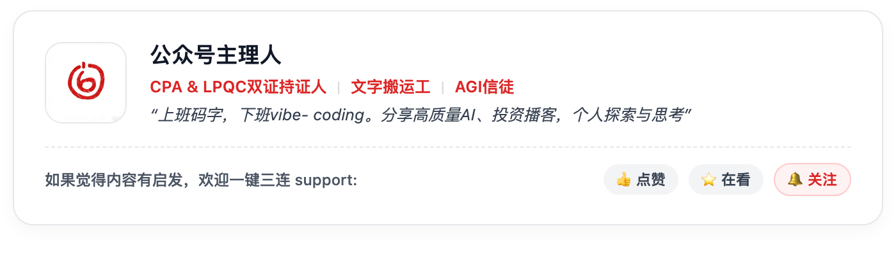

# 🛡️ ob-baodan：基于 Obsidian 与 DeepSeek 的全家保单数字化管理系统

<p align="center">
  
  
  
  
  
</p>

> **让复杂的家庭保险，变成井井有条的本地知识资产。**  
> 一套集成了 **本地绝对隐私脱敏**、**多文件保单套件自动聚合**、**DeepSeek AI 条款专家精读**、**双模式智能理赔追问** 与 **6 大维度全景可视化统计大盘** 的端到端开源解决方案。

---

## 🌟 为什么需要 ob-baodan？

家庭配置保单往往面临几大痛点：
1. **保单分散杂乱**：纸质凭证、公众号推文、微信文件群各放一份，出了险根本想不起能赔什么；
2. **条款晦涩冗长**：一份保单往往附带 80 页条款、30 页增值手册，普通人根本看不懂免赔额阶梯与免责暗坑；
3. **大模型隐私泄漏风险**：将包含姓名、身份证、电话、保单号的真实保单直接丢给商业大模型，隐私荡然无存；
4. **多文件拆散错乱**：保险公司往往下发“凭证+条款+增值手册”多个 PDF，传统工具容易误拆分为多个重复混乱的笔记；
5. **缺乏家庭宏观视角**：各人保额多少？年总保费是多少？哪个月份扣款压力最大？哪个家庭成员保障存在严重短板？

**ob-baodan 专为解决上述问题而生。**

---

## ⚡ 核心特性一览

### 1. 🔒 本地靶向绝对隐私脱敏先行 (PII Zero-Leakage)
* 在向 DeepSeek 发送任何内容前，所有打码操作**全部在您本机毫秒级完成**；
* 覆盖：**身份证号**、**真实姓名**、**出生日期**、**手机号码**、**银行卡号**、**保单合同号**、**经办核保人**；
* 真实映射关系严格保存在本地 `_system/policy_secret_mapping.json`，绝不出内网！
* 采用空间坐标识别算法，精准区分【投保人】与【被保险人】，准确提取子女、配偶、本人等家庭关系，角色不倒置。

### 2. 📦 多文件保单套件智能聚合 (Policy Suite Bundling)
* 自动识别保单文档类型：**主单凭证 (Master)**、**条款全文 (Clauses)**、**增值服务手册 (Value-Added)**；
* 自动将分散的 PDF 关联为一个保单套件，**只沉淀 1 份唯一规范的主保单笔记**，条款与手册自动归档于末尾折叠区，杜绝垃圾碎片笔记。

### 3. 🤖 DeepSeek AI 三合一专家精读与排雷
* 整合凭证数据 + 80页条款核心 + 增值服务细则，由 DeepSeek 输出专业研读报告：
  - **核心保障与阶梯给付比例**（0免赔、1万以内30%、1万以上100%、未走医保断崖下降至60%）；
  - **免责暗坑全面排查**（公立二级以上普通部限制、特需部/私立除外、30天等待期、既往症除外）；
  - **特别约定与身份核验闸门**（如就医医院等级限制、证明投被保人家属关系的户口本/出生医学证明）；
  - **增值服务兑现通道**（三甲门诊绿通 5 个工作日安排、住院垫付申请路径）；
  - **一句话理赔口诀**（给家长的极简理赔大白话指南）。

### 4. 💬 双模式 AI 智能理赔追问体系
* **笔记内置即时追问 (Inline QA)**：自带常用快捷胶囊（“小孩肺炎住院花8000能赔多少”、“特需部赔不赔”、“自费药报不报”），点击即可就地输出分步骤数学计算推导，支持一键 `📌 保存此问答至保单笔记末尾`；
* **右侧独立追问侧边栏 (Side Panel Chat)**：类似专属伴读助理，支持多轮连贯上下文问答。

### 5. 📈 6 大核心维度可视化统计大盘 (Dynamic Charts)
结合国际标准 CFP 家庭财务规划模型，原生支持 **Mermaid** 矢量交互图表与 **Dataview** 实时响应：
1. **险种类别分布**：百万医疗、重大疾病、意外险配置平衡度；
2. **家庭成员配比**：核验“先大人后小孩，保费向经济支柱倾斜（占比超85%）”黄金法则；
3. **保额排行与保额杠杆**：全家千万级保额覆盖与千倍对冲杠杆率分析；
4. **12个月续保现金流月历**：月度扣款压力热力分布，提前预警支出峰值月份（如8月集中扣费）；
5. **承保保司资产集中度**：央企大型保司 vs 头部上市机构 vs 专业互联网保司分布；
6. **缴费期限与资产属性**：一年期纯消费型防线 vs 终身确定型资产。

### 6. 🌐 零依赖独立离线 Web 看板（无需安装 Obsidian，双击 HTML 即看）
* 引擎在解析沉淀的同时，自动在根目录编译单个纯静态的 `baodan_dashboard.html`；
* **完全离线可用**：不依赖任何网络服务器，零第三方在线 CDN 依赖，在任何浏览器（Chrome/Safari/Edge/手机端）中双击即可运行；
* **智能 3 步增量录入与本地脱敏呈现（类似 Obsidian 体验）**：
  1. **放入保单文件**：支持拖拽 PDF、TXT、MD 文件或粘贴文本，浏览器端纯本地解析；
  2. **本地脱敏直观呈现**：一键在浏览器本地将身份证、姓名、手机号、保单号打码，脱敏文档直接在 Web 看板以彩色徽章高亮呈现，可查看映射字典或导出 `secret.json`；
  3. **大模型精读与同步大盘**：一键调用 DeepSeek AI（或离线智能规则引擎），穿透条款责任与免责，全家总保额、年保费、杠杆比、条形码图谱与日历即时动态刷新，并支持一键下载标准 Markdown 保单笔记；
* **现代交互体验**：包含拖拽式泳道看板、条形码抗风险频谱图、临近续期预警卡片、实时搜索筛选与右侧滑出式 AI 条款精读抽屉；
* **打印/PDF 导出友好**：内置 `@media print` 打印优化样式，一键打印或导出家庭保单全景体检报告。

---

## 📁 仓库与知识库目录结构

```
ob-baodan/
├── SKILL.md                 # Agent Skill 规范与工作流定义
├── README.md                # 项目文档
├── scripts/
│   ├── policy_processor.py  # 本地脱敏、套件聚合与 AI 分析核心引擎 (Python)
│   └── dashboard_generator.py # 独立离线 Web 看板生成器
├── plugin/                  # Obsidian 社区专属插件 (baodan-ai)
│   ├── manifest.json
│   ├── main.js              # 编译好的插件脚本
│   ├── styles.css           # 交互组件与聊天气泡样式
│   └── src/
│       ├── main.ts          # 插件主入口
│       └── chat-view.ts     # 右侧独立追问面板
└── vault-template/          # 开箱即用的保单知识库模板
    ├── baodan_dashboard.html # 零依赖独立离线 Web 看板（无需 Obsidian 双击即看）
    ├── 00_看板中心/
    │   ├── 📊 保单全景看板.md
    │   ├── 📈 全家保单多维数据统计大盘.md
    │   ├── 📅 年度缴费日历与预算.md
    │   └── 📖 保单管理系统使用说明.md
    ├── 01_保单库/            # 沉淀的规范化保单笔记
    │   ├── 医疗险/
    │   ├── 重疾险/
    │   └── 意外险/
    ├── 02_原始保单_PDF/     # 存放待处理的保单文件 (已受 gitignore 保护)
    └── _system/             # 配置文件与本地映射表 (已受 gitignore 保护)
        ├── config.example.json
        └── policy_secret_mapping.example.json
```

---

## 🚀 快速上手指南

### 1. 克隆项目与安装依赖
```bash
git clone https://github.com/yww520/ob-baodan.git
cd ob-baodan

# 安装 Python 解析依赖
pip install pymupdf requests pyyaml
```

### 2. 初始化配置
复制配置文件模板：
```bash
cp vault-template/_system/config.example.json vault-template/_system/config.json
```
在 `config.json` 中填入您的 DeepSeek API Key（或配置系统环境变量 `export DEEPSEEK_API_KEY="sk-..."`）。

### 3. 一键解析保单
将您的保单 PDF（如电子保单凭证、条款或增值手册）放入 `vault-template/02_原始保单_PDF/` 目录下，运行：
```bash
python3 scripts/policy_processor.py --batch --vault "./vault-template"
```
终端将自动输出脱敏打码日志、DeepSeek 精读过程，并生成唯一的结构化保单笔记与全套统计图表！

### 4. 在 Obsidian 中打开与体验
1. 使用 Obsidian 打开 `vault-template` 文件夹作为仓库；
2. 在设置中开启第三方插件：`dataview`、`obsidian-kanban` 与 `baodan-ai`；
3. 打开 `00_看板中心/📊 保单全景看板.md` 与 `📈 全家保单多维数据统计大盘.md` 查看全景图表！

### 5. 没有安装 Obsidian？双击即可在浏览器中看全景大盘！
直接使用任何浏览器（Chrome / Safari / Edge）双击打开模板目录下的 **`vault-template/baodan_dashboard.html`**；
或者在终端执行一键编译并在默认浏览器中自动打开：
```bash
python3 scripts/policy_processor.py --html --open --vault "./vault-template"
```
包含完整的泳道看板、SVG 交互式图表、60天临近续费提醒、搜索筛选与侧边滑出式 AI 条款精读抽屉。

---

## 🛡️ 隐私与安全承诺

- **无个人敏感信息上云**：所有原始敏感数据（真实姓名、身份证号码、出生日期、银行卡号、手机号、合同单号）在离开本机网络前，已被不可逆脱敏替换为加密代号。
- **纯本地锁存**：映射字典 `policy_secret_mapping.json` 与原始 PDF 文件默认受 `.gitignore` 保护，绝不会被推送到任何远程代码仓库。

---

## 👨‍💻 关于作者与交流 (About the Author)

本项目由微信公众号 **「6点关机」** 主理人设计与开源维护。

> **CPA & LPQC 双证持证人 ｜ 文字搬运工 ｜ AGI 信徒**  
> *“上班码字，下班 vibe-coding。分享高质量 AI 提效、投资播客精读与个人探索思考。”*

<p align="center">
  
</p>

如果您在日常使用、全家保单数字化整理或大模型落地实践中有所收获，欢迎关注微信公众号 **「6点关机」**，一同探讨 AI Agent 与数字资产管理的前沿实践。如果觉得好用，也欢迎为本项目点亮一颗 ⭐️ Star 支持！

---

## 📄 License
[MIT License](LICENSE) © 2026 yww520
