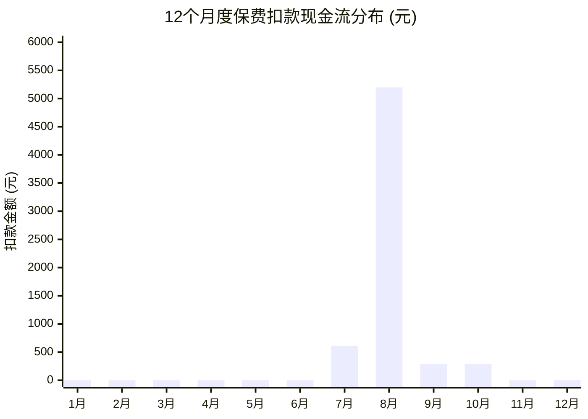

# 📅 全家保单年度缴费日历与保障总览

> [!ABSTRACT] 仪表盘说明
> 本页面由 **Dataview 插件** 与 **Mermaid 图表** 实时动态汇总。
> 只要在保单库中新增或修改保单笔记，此处的表格、统计与缴费时间线将**自动同步更新**。

---

## ⏰ 1. 年度续期缴费时间线与现金流分布

### 1.1 12个月度续期扣款日历分布图 (元)


### 1.2 扣款时间证明细表（按每年扣款日排序）
```dataview
TABLE WITHOUT ID
  renewal_date AS "每年扣款日",
  file.link AS "保单产品名称",
  insured AS "被保险人",
  category AS "险种类型",
  annual_premium AS "年交保费(元)",
  payment_period AS "缴费期限",
  status AS "当前状态"
FROM "01_保单库"
SORT renewal_date ASC
```

---

## 🛡️ 2. 全家保障额度分布与汇总

```dataview
TABLE WITHOUT ID
  file.link AS "产品名称",
  insured AS "被保险人",
  insurer AS "承保公司",
  category AS "险种分类",
  sum_insured AS "基本保额(元)",
  coverage_period AS "保障期间",
  status AS "状态"
FROM "01_保单库"
SORT sum_insured DESC
```

---

## 💡 3. 保费支出预算与断缴防范提示

> [!WARNING] 宽限期与现金流避坑指南
> - **8月份支出峰值**：每年 8 月为全家最大保费支出期（达尔文7号 5,200 元扣款），建议在 7 月底前备足账户活期余额。
> - **60天宽限期**：长期人身险（重疾/寿险）在交费对应日后通常享有 60 天宽限期。宽限期内出险，保险公司仍然承担赔付责任（但会扣除所欠保费）。
> - **2年复效期**：超过60天未缴费，保单失效；2年内可申请复效，但需重新健康告知并重新计算等待期！
> - **一年期医疗险续保**：百万医疗险一般为 1 年期，即使保证续保 20 年，也必须在到期日前完成扣款，无 60 天宽限期。
