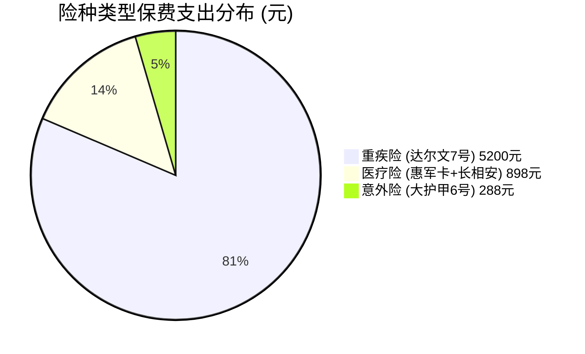
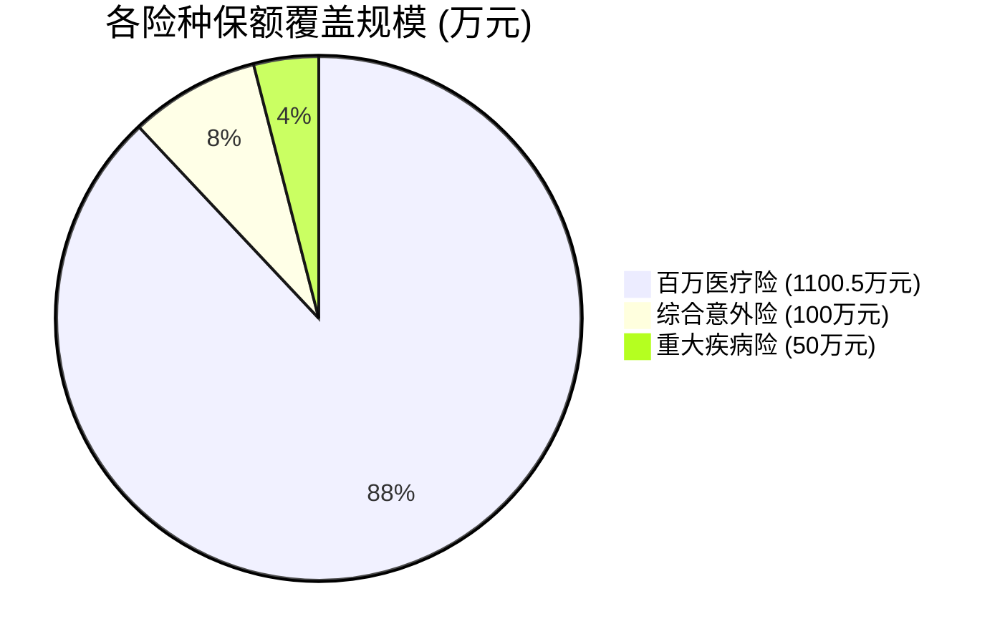
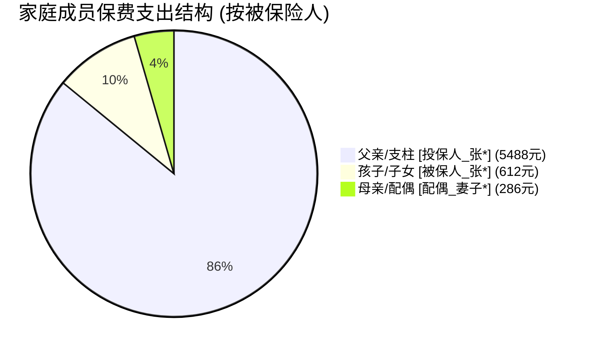
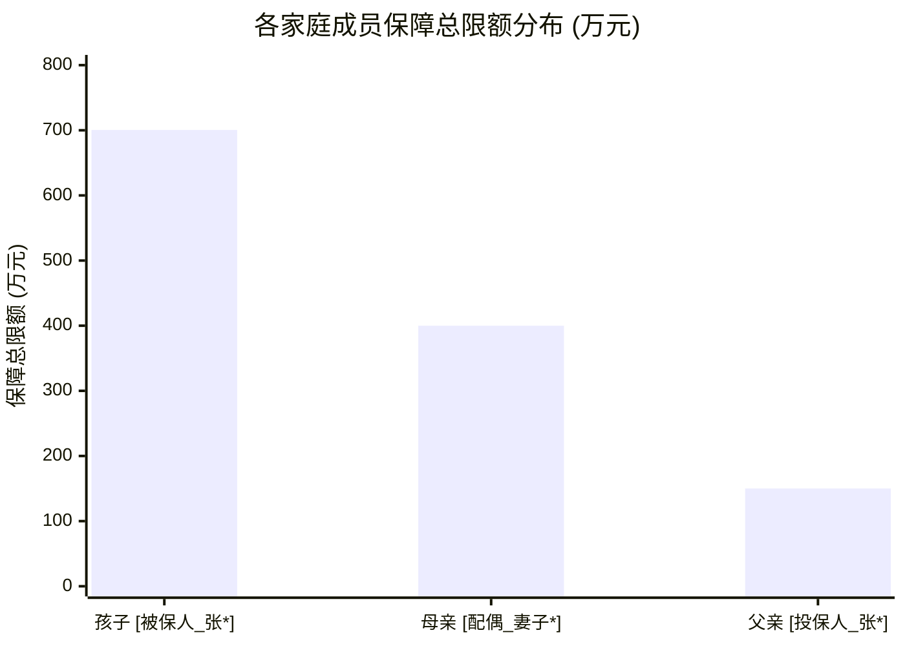
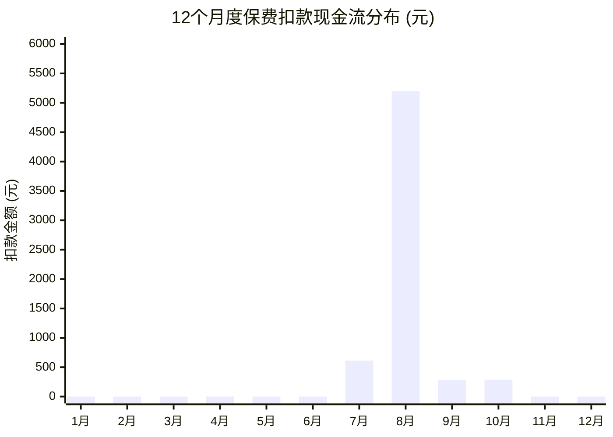
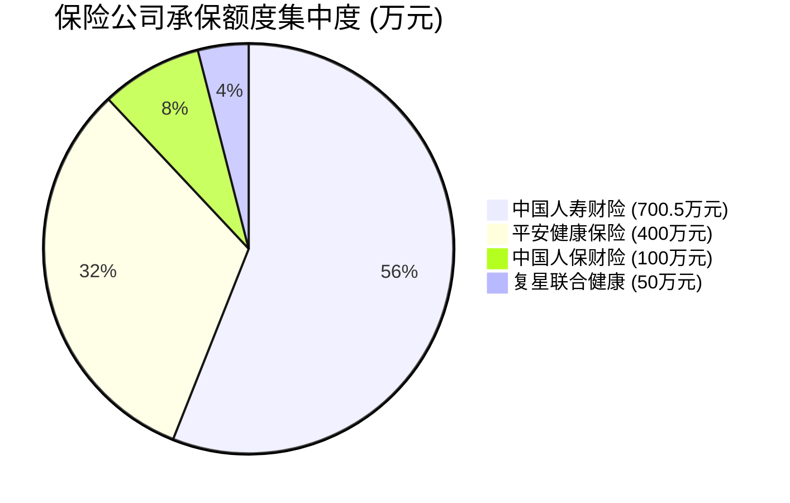

# 📈 全家保单多维数据统计与可视化大盘

> [!ABSTRACT] 仪表盘说明
> 本大盘基于全家保单库的结构化元数据，从**险种类别**、**家庭成员（被保险人）**、**保障额度与杠杆**、**12个月缴费现金流**、**承保机构集中度**、**期限资产属性**等 6 大核心维度进行深度全景透视。
> 所有图表与数据均基于原生 Mermaid 与 Dataview 动态渲染，保单库有任何增减或修改均会自动同步。

---

## 💎 1. 全家保单资产核心 KPI 指标板

| 📊 保障中保单数 | 🛡️ 全家保障总限额 | 💳 年度保费总支出 | ⚡ 综合保额杠杆比 | 👨‍👩‍👦 覆盖家庭成员 |
| :---: | :---: | :---: | :---: | :---: |
| **4 份** | **￥12,505,000 元** *(1,250.5万元)* | **￥6,386.00 元** | **1,958 倍** | **3 人 (父/母/子)** |

> [!TIP] 专家财务健康度诊断
> - **保费收入比（双十原则）**：当前全家年保费约 6,386 元。若家庭年总收入在 7~15 万元之间，保费占比控制在 5%~9%，完全处于**安全健康红线内**。
> - **保额覆盖率**：全家医疗总额度突破千万元（含 700.5 万惠军尊享卡），极端大病医疗抗风险能力极强；重疾险定额给付 50 万，可有效对冲顶梁柱 3~5 年收入中断风险。

---

## 📊 2. 核心维度一：按【险种类别】统计与诊断

### 2.1 各险种年度保费支出占比 (年保费共 ￥6,386.00 元)


### 2.2 各险种保额覆盖规模分布 (总额 1,250.5 万元)


### 2.3 险种配置结构明细表
```dataview
TABLE WITHOUT ID
  category AS "险种类型",
  length(rows) AS "保单数量",
  sum(rows.sum_insured) AS "总保额(元)",
  sum(rows.annual_premium) AS "年度保费(元)"
FROM "01_保单库"
WHERE status = "保障中"
GROUP BY category
SORT sum(rows.annual_premium) DESC
```

> [!NOTE] 险种平衡度体检结论
> - **已覆盖**：✅ 医疗险（全家防线）、✅ 重疾险（收入补偿）、✅ 意外险（身故残疾与意外医疗）。
> - **待完善（缺口）**：❌ **定期寿险**（家庭顶梁柱[投保人_张*]目前缺少一份定期寿险，建议补充 100~200 万定寿，防范极端身故负债风险）；❌ **储蓄与养老金**（未来可结合税延或增额终身寿规划孩子教育与个人养老）。

---

## 👨‍👩‍👧 3. 核心维度二：按【家庭成员（被保险人）】统计与诊断

### 3.1 各家庭成员年度保费支出配比


### 3.2 各家庭成员保障总限额对比 (万元)


### 3.3 家庭成员保障明细清单
```dataview
TABLE WITHOUT ID
  insured AS "被保险人",
  relationship AS "与投保人关系",
  length(rows) AS "保单数",
  sum(rows.sum_insured) AS "保障总额(元)",
  sum(rows.annual_premium) AS "年度总保费(元)"
FROM "01_保单库"
WHERE status = "保障中"
GROUP BY insured
SORT sum(rows.annual_premium) DESC
```

> [!SUCCESS] 科学投保原则核验
> - **经济支柱优先原则（达标 ✅）**：保费倾斜向顶梁柱（父亲年保费占比高达 **85.9%**），因为大人的健康才是孩子最大的保障，完全符合标准资产配置逻辑。
> - **孩子高杠杆守护（达标 ✅）**：孩子以仅 612 元保费撬动了 700.5 万的尊享版医疗险，无过度买昂贵捆绑型少儿重疾险，杠杆效率极高。

---

## ⚡ 4. 核心维度三：按【保障额度与保额杠杆】统计排行

```dataview
TABLE WITHOUT ID
  file.link AS "保单产品名称",
  insured AS "被保险人",
  category AS "险种类型",
  sum_insured AS "基本保额(元)",
  annual_premium AS "年交保费(元)",
  payment_period AS "交费期限",
  status AS "状态"
FROM "01_保单库"
WHERE status = "保障中"
SORT sum_insured DESC
```

| 排名 | 保单产品名称 | 被保人 | 险种分类 | 基本保额 | 年度保费 | 保额杠杆倍数 | 核心赔付机制 |
| :---: | :--- | :---: | :---: | :---: | :---: | :---: | :--- |
| 🥇 | **退役军人家庭医疗卡** | `[被保人_张*]` (子女) | 医疗险 | **700.5 万元** | ￥612.00 | **11,446 倍** | 0免赔，1万内30%，1万上100% |
| 🥈 | **平安长相安长期医疗** | `[配偶_妻子*]` (配偶) | 医疗险 | **400.0 万元** | ￥286.00 | **13,986 倍** | 1万免赔，100%报销，保证续保20年 |
| 🥉 | **人保大护甲6号意外险** | `[投保人_张*]` (本人) | 意外险 | **100.0 万元** | ￥288.00 | **3,472 倍** | 伤残按级赔，意外医疗0免赔100% |
| 4 | **复星联合达尔文7号** | `[投保人_张*]` (本人) | 重疾险 | **50.0 万元** | ￥5,200.00 | **96 倍** | 确诊即赔50万，不限用途 |

---

## 📅 5. 核心维度四：按【12个月缴费现金流与峰值】统计

### 5.1 12个月度续期扣款日历分布图 (元)


### 5.2 续保扣款时间清单
```dataview
TABLE WITHOUT ID
  renewal_date AS "每年扣款日",
  file.link AS "保单产品名称",
  insured AS "被保险人",
  annual_premium AS "扣款金额(元)",
  payment_period AS "交费期间",
  insurer AS "承保公司"
FROM "01_保单库"
WHERE status = "保障中"
SORT renewal_date ASC
```

> [!WARNING] 现金流预警
> 每年 **8月份** 为全家保费最大流出月（达尔文7号需扣款 5,200 元，占全年支出超 80%）。建议在每年 7 月底前确认扣款银行账户余额充足，避免因扣款失败触发 60 天宽限期。

---

## 🏢 6. 核心维度五：按【承保保险公司集中度】统计



```dataview
TABLE WITHOUT ID
  insurer AS "保险机构名称",
  length(rows) AS "承保保单数",
  sum(rows.sum_insured) AS "承保总保额(元)",
  sum(rows.annual_premium) AS "年交总保费(元)"
FROM "01_保单库"
WHERE status = "保障中"
GROUP BY insurer
SORT sum(rows.sum_insured) DESC
```

---

## 🔒 7. 核心维度六：按【缴费期限与资产属性】统计

```dataview
TABLE WITHOUT ID
  payment_period AS "缴费期限类型",
  length(rows) AS "保单数量",
  sum(rows.annual_premium) AS "年度保费总计(元)",
  sum(rows.sum_insured) AS "保障总额(元)"
FROM "01_保单库"
WHERE status = "保障中"
GROUP BY payment_period
SORT sum(rows.annual_premium) DESC
```
