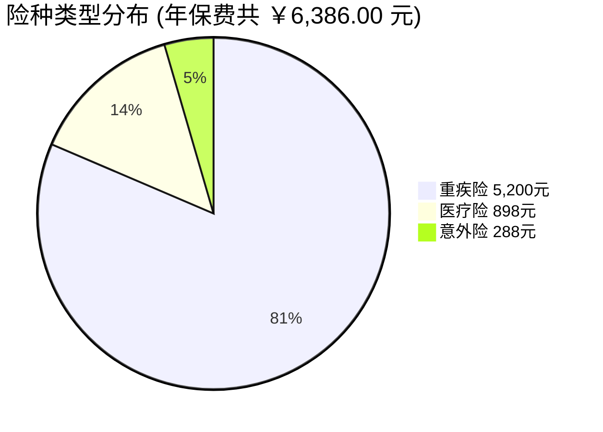
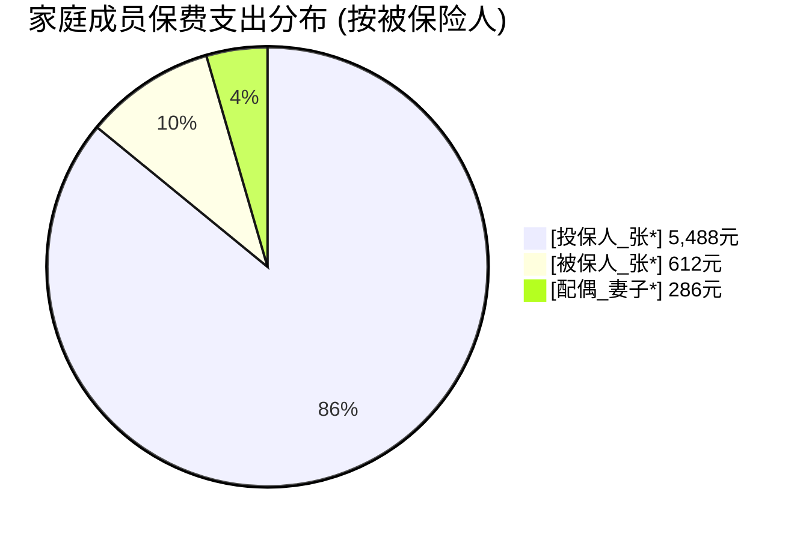

# 📊 全家保单管理全景看板

> [!ABSTRACT] 🚀 多维数据统计与导航中心
> - **📈 深度统计大盘**：[[📈 全家保单多维数据统计大盘]] *(含 6 大核心维度、杠杆测算、现金流月历与机构评级)*
> - **📅 缴费日历预算**：[[📅 年度缴费日历与预算]] *(按月份追踪续期扣款与宽限期)*
> - **💎 核心资产指标**：**4 份保单** ｜ 保障总限额 **￥12,505,000.00 元** *(约 1250.5 万元)* ｜ 年度总保费 **￥6,386.00 元** ｜ 综合杠杆 **1958 倍**





---

## 🛡️ 缴费保障中

- [ ] [[医疗险-退役军人家庭-全年医疗费用保险卡（尊享版）]]<br>💰 保额：700.5万元 ｜ 💳 年交/趸交：￥612.00 ｜ 👤 被保人：[被保人_张*] (子女) ｜ 📅 扣款日：07-15
- [ ] [[示例-平安长相安长期百万医疗保险]]<br>💰 保额：400.0万元 ｜ 💳 年交/趸交：￥286.00 ｜ 👤 被保人：[配偶_妻子*] (配偶) ｜ 📅 扣款日：09-01
- [ ] [[示例-人保大护甲6号旗舰版个人意外险]]<br>💰 保额：100.0万元 ｜ 💳 年交/趸交：￥288.00 ｜ 👤 被保人：[投保人_张*] (本人) ｜ 📅 扣款日：10-20
- [ ] [[示例-复星联合达尔文7号重大疾病保险]]<br>💰 保额：50.0万元 ｜ 💳 年交/趸交：￥5,200.00 ｜ 👤 被保人：[投保人_张*] (本人) ｜ 📅 扣款日：08-15


## ⏳ 等待期 / 待生效

- [ ] *(新投保保单在此处排队，等待期满后拖入「保障中」)*


## 🏆 已交费期满 (终身享有)

- [ ] *(缴费期满但终身继续保障的重疾或寿险归档于此)*


## 🔔 缴费预警 / 宽限期内

- [ ] *(每年临近交费日或正在扣款的保单)*


## 📝 理赔与变更中

- [ ] *(正在向保险公司申请理赔报案或变更资料的保单)*


%% kanban:settings
```
{"kanban-plugin":"basic"}
```
%%
